# ha-train-board-card

[](https://www.home-assistant.io/integrations/marketplace/)
[](https://github.com/juju35/ha-train-board-card/actions/workflows/hacs.yml)
[](https://github.com/juju35/ha-train-board-card/actions/workflows/validate.yml)
[](https://github.com/juju35/ha-train-board-card/actions/workflows/lint.yml)
[](https://github.com/juju35/ha-train-board-card/releases/latest)
[](https://github.com/juju35/ha-train-board-card/blob/main/LICENSE)
[](https://buymeacoffee.com/julienstep9)

<p align="center"></p>

<p align="center">
  &nbsp;&nbsp;
  &nbsp;&nbsp;
  &nbsp;&nbsp;
  &nbsp;&nbsp;
  &nbsp;&nbsp;
  &nbsp;&nbsp;
  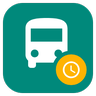
</p>
<p align="center">
  &nbsp;&nbsp;
  
</p>

An animated departures and arrivals board of a railway station for Home Assistant: the next trains with their time, train type, destination, platform and status (on time, delayed, boarding, cancelled), and a compact mini card with the next train. The header is an illustration of a station where a train waits at the platform and leaves, or comes in and stops, by day and by night.

The cards read the sensors of **thirteen integrations** — [DB Infoscreen](https://github.com/FaserF/ha-db_infoscreen), [National Rail UK](https://github.com/jfparis/homeassistant_nationalrail), [National Rail Departure Times](https://github.com/crismc/homeassistant_nationalrailtimes_integration), [Swiss Transport](https://github.com/prusuino/ha_swiss_transport), [Public Transport](https://github.com/juju35/ha-public-transport), [Train Traveler](https://github.com/Matthyeux/train-traveler), [GTFS2](https://github.com/vingerha/gtfs2) and the Nederlandse Spoorwegen, Trafikverket Train, Swiss public transport, ViaggiaTreno, NMBS and UK Transport integrations included in Home Assistant: the integration is **detected automatically** from the entity, and the card adapts to what it provides.

[](https://my.home-assistant.io/redirect/marketplace_repository/?owner=juju35&repository=ha-train-board-card&category=plugin)

| Departures | Arrivals |
|---|---|
| <picture><source media="(prefers-color-scheme: dark)" srcset="https://raw.githubusercontent.com/juju35/ha-train-board-card/main/screenshots/card-dark.png">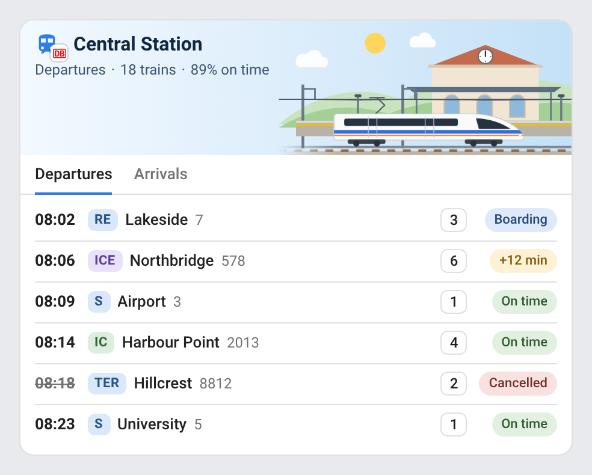</picture> | <picture><source media="(prefers-color-scheme: dark)" srcset="https://raw.githubusercontent.com/juju35/ha-train-board-card/main/screenshots/card-arrivals-dark.png">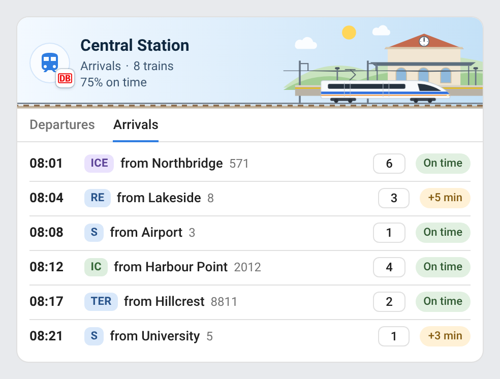</picture> |
| <picture><source media="(prefers-color-scheme: dark)" srcset="https://raw.githubusercontent.com/juju35/ha-train-board-card/main/screenshots/departure-dark.gif">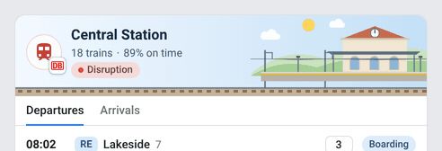</picture> | <picture><source media="(prefers-color-scheme: dark)" srcset="https://raw.githubusercontent.com/juju35/ha-train-board-card/main/screenshots/arrival-dark.gif">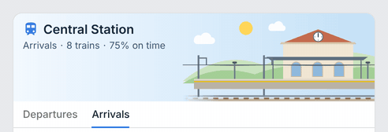</picture> |

| Mini card | At night |
|---|---|
| <picture><source media="(prefers-color-scheme: dark)" srcset="https://raw.githubusercontent.com/juju35/ha-train-board-card/main/screenshots/mini-card-dark.png">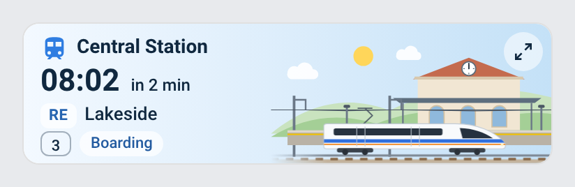</picture> | 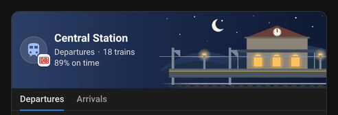 |

## Features

- Two cards: a full **Train Board Card** and a compact **Train Board Mini Card**, of type `custom:train-board-card` and `custom:train-board-mini-card`
- **Brand badge**: the logo of the railway behind the integration (Deutsche Bahn, National Rail, NS, SNCF, SBB, Trafikverket, Trenitalia, SNCB, or the Public Transport icon) on the header icon, like the other multi-brand cards; `brand` (YAML only) picks another bundled logo, e.g. `obb` for a DB Infoscreen station on the ÖBB backend
- Thirteen integrations, detected from the entity (its integration in the entity registry, else its attributes), or forced with `integration`; see [Supported integrations](#supported-integrations)
- **Animated header**: a station with its canopy, arched windows and a clock whose hand turns, catenary, platform with its yellow safety line, and a generic train (no operator livery) with its pantograph and an occasional spark. On the Departures tab the train waits at the platform then leaves to the right; on the Arrivals tab it comes in from the left and stops; the animation starts over when the tab changes. Nothing moves under the text: at the left, on the sky, the round tinted train icon (40 px, the brand badge at its bottom right) and beside it the station name and the statistics
- **Day and night**: at night the sky turns dark blue with stars and the moon, the station's windows and the platform lamps light up, the train's headlight shines. `illustration_theme: auto` follows the Home Assistant theme (night with a dark theme, day with a light theme), or force `day` / `night`; `illustration: false` gives a classic header
- **Statistics** in the header: « 18 trains · 89 % on time », the share of trains on time computed over the board, with the board's name first (« Departures · … ») when there are no tabs to show it
- **Status pill** on the title row of the header, in the colour of the header icon: **On time** (green), **Delays** (orange) or **Disruption** (red, a cancelled train) among the trains listed, **Scheduled** (grey, timetable only) or **No trains**; when the title lacks room it goes to its own line under the statistics, and on a very narrow card only its dot shows
- **Departures / Arrivals tabs**: the arrivals come from a second sensor (`arrival_entity`); without arrivals the tabs are not shown
- **Board**: scheduled time, train type pill coloured by family (high speed, intercity, regional; [your own colours](#train-type-colours)), destination (« from … » for arrivals), train number, platform in a small frame (orange when it changed), status pill: **on time**, **+12 min**, **boarding** (two minutes before), **arrived**, **delayed** (no time given), **cancelled** (the time struck through). Columns the integration does not provide are not shown
- **Train details** on a click: a popup at the top of the card with the scheduled and expected times, platform (and its change), operator, calling points and disruption messages; it closes on a click anywhere else, with Escape, or when the card leaves the page
- **Day separator**: « Tomorrow » (then the date) between the trains of two days, when the list runs into the next day
- **Station notices** (lift out of order, works…) in a line above the board, all of them in a popup on a click
- Filters: `platforms`, `train_types` (categories or families), `hide_cancelled`; `max_trains` rows
- **Mini card**: the same banner, lower, with the same 40 px round icon and the next train beside it — large time with its status pill right after it (the header icon in the same colour), type and destination, platform and « in 8 min » (beside the scenery, where the time row lacks room, the pill takes the last row and « in 8 min » the time row); with no train to show, the station's name and the board's pill. Its detail button (top right) switches it to the full board and back; a click anywhere outside the card brings the compact view back
- Visual editor for both cards (no YAML needed); options left at their default are kept out of the YAML
- Respects the « reduce motion » setting of the system: the train stays at the platform
- Local times of the integrations read in Home Assistant's time zone, clock times in your 12 / 24 h setting
- Light and dark mode, English, French, German, Spanish, Serbian (Cyrillic and Latin), Italian, Dutch, European Portuguese, Polish, Romanian, Danish, Swedish, Bulgarian, Russian, Ukrainian, Hungarian, Slovak, Czech, Slovenian, Latvian and Greek
- Single file, no external dependency, no external picture: the illustration is drawn in SVG

## Supported integrations

| Integration | Link | Departures | Arrivals | Platform | Train type | What else |
|---|---|---|---|---|---|---|
|  **DB Infoscreen** (`db_infoscreen`, custom) | [FaserF/ha-db_infoscreen](https://github.com/FaserF/ha-db_infoscreen) | ✓ board | ✓ second entry in arrival mode | ✓ with changes | ✓ ICE, IC, RE, S… and number | Delay, cancellation, via (with « keep route »), messages, station notices |
|  **National Rail UK** (`nationalrailuk`, custom) | [jfparis/homeassistant_nationalrail](https://github.com/jfparis/homeassistant_nationalrail) | ✓ board | — | ✓ | — | Expected time, « Delayed », « Cancelled », calling points with their times |
|  **National Rail Departure Times** (`nationalrailtimes`, custom) | [crismc/homeassistant_nationalrailtimes_integration](https://github.com/crismc/homeassistant_nationalrailtimes_integration) | ✓ next service | — | ✓ | — | Expected time, operator, calling points, delay and cancel reasons, station messages |
|  **Swiss Transport** (`swiss_transport`, custom) | [prusuino/ha_swiss_transport](https://github.com/prusuino/ha_swiss_transport) | ✓ station board, or a saved connection | — | ✓ with changes | ✓ IC, IR, RE, S… and number | Delay, cancellation and alerts (with the real-time token) |
|  **Public Transport** (`public_transport`, custom) | [juju35/ha-public-transport](https://github.com/juju35/ha-public-transport) | ✓ stop or line sensor | — | — | ✓ line, in its colour | Real time or timetable, alerts |
|  **Train Traveler** (`train_traveler`, custom) | [Matthyeux/train-traveler](https://github.com/Matthyeux/train-traveler) | ✓ journeys | — | — | ✓ TER, TGV INOUI… | Delay, disruptions, arrival at destination |
| **GTFS2** (`gtfs2`, custom) | [vingerha/gtfs2](https://github.com/vingerha/gtfs2) | ✓ next departures of a route | ✓ a route sensor in arrival mode | — | ✓ route short name (a line name such as `C17` shown whole, in the route's colour), category from the trip id (SNCF: `TER`), train number (trip short name, or a numeric headsign) | Destination stop (or headsign), arrival at destination, GTFS-RT expected times, stop alerts |
|  **Nederlandse Spoorwegen** (built in) | [nederlandse_spoorwegen](https://www.home-assistant.io/integrations/nederlandse_spoorwegen/) | ✓ next trip and the next one | — | ✓ with changes | — | Delay, cancellation, route |
|  **Trafikverket Train** (built in) | [trafikverket_train](https://www.home-assistant.io/integrations/trafikverket_train/) | ✓ next train and the two next times | — | — | — | Delay, cancellation, deviation and other information |
|  **Swiss public transport** (built in) | [swiss_public_transport](https://www.home-assistant.io/integrations/swiss_public_transport/) | ✓ three next connections | — | ✓ first one | ✓ first one | Delay of the first one |
|  **ViaggiaTreno** (built in) | [viaggiatreno](https://www.home-assistant.io/integrations/viaggiatreno/) | ✓ the followed train | — | — | ✓ FR, IC, REG… and number | Delay, cancellation |
|  **NMBS / SNCB** (built in) | [nmbs](https://www.home-assistant.io/integrations/nmbs/) | ✓ next train (liveboard or connection) | — | ✓ | ✓ IC, S, L… and number | Delay, cancellation, via |
|  **UK Transport** (built in) | [uk_transport](https://www.home-assistant.io/integrations/uk_transport/) | ✓ next trains (live train time sensor) | — | ✓ | — | Expected time, cancellation, operator |

The real station boards (DB Infoscreen, National Rail UK, Swiss Transport, Public Transport) fill the card; the route integrations (Nederlandse Spoorwegen, Trafikverket, Swiss public transport, Train Traveler…) give one to three trains between two stations (GTFS2 up to ten), and the card shows what they provide: no tabs without arrivals, no platform column without platforms, no type pill without categories, no status pill for a train known from the timetable only.

The sensor to pick:

- **DB Infoscreen**: the station's departures sensor (`sensor.<station>_departures`); for the Arrivals tab, add the station a second time in arrival mode and pick that sensor as `arrival_entity`. Turn on **Keep route** in the integration's options to see the via stations and the origin of arriving trains
- **Swiss Transport**: the departures sensor of a station, or the sensor of a saved connection
- **Public Transport**: the stop's « Next departure » sensor (or a line sensor)
- **Trafikverket Train** and **Swiss public transport**: the departure time sensor of the route; the card reads the other sensors of its device (delay, platform, line, next departures)
- **Train Traveler**: the journeys sensor (`sensor.train_traveler_<start>_<end>_journeys`), or a next journey sensor
- **GTFS2**: the route sensor (start stop → end stop) with its next departures, from any GTFS feed — e.g. SNCF's open data (TER, Intercités, TGV), which needs no token. Add the GTFS-RT trip updates URL to the feed for the expected times: trains with real-time data get their status pill, the others are shown from the timetable. A GTFS timetable has no platforms, so the platform column is hidden. When the headsign holds the train number (SNCF), the destination stop is shown and the headsign is the train number. For the Arrivals tab, pick the sensor of the reverse route as `arrival_entity`

## Prerequisites

Home Assistant 2024.8 or later, and one of the integrations above set up for your station.

## Installation

### Via the Marketplace (recommended)

Click the button below to add the repository directly:

[](https://my.home-assistant.io/redirect/marketplace_repository/?owner=juju35&repository=ha-train-board-card&category=plugin)

Then click **Install**, and reload your browser when the Marketplace asks you to.

Or manually:

1. Open **Settings → Marketplace → Add from link** (top right; this needs a GitHub account connected)
2. Add `https://github.com/juju35/ha-train-board-card` — Type: **Dashboard**
3. Open **Train Board Card** and click **Install**
4. Clear your browser cache and refresh

The Marketplace adds the resource `/local/community/ha-train-board-card/train-board-card.js` for you.

### Manual

1. Download `train-board-card.js` and the `train-board-card.i18n.*.js` translation files from the [latest release](https://github.com/juju35/ha-train-board-card/releases/latest)
2. Copy them all to `/config/www/` (without the translation files, the cards show in English)
3. Go to **Settings → Dashboards → ⋮ → Resources** → Add resource:
   - URL: `/local/train-board-card.js`
   - Type: **JavaScript Module**
4. Clear your browser cache and refresh

## Configuration

### Visual editor

Edit a dashboard, click **Add card** and search for **Train Board Card** or **Train Board Mini Card**. The first sensor of a supported integration is preselected; pick the departures sensor of your station (the list shows the sensors of the supported integrations), an optional arrivals sensor, a title, the illustration theme, the default tab, the number of trains, the columns, the filters and the language. The mini card's editor also has the options of its unfolded view. The preview updates live, and options left at their default are kept out of the generated YAML.

### Minimal

```yaml
type: custom:train-board-card
entity: sensor.koln_hbf_departures
```

```yaml
type: custom:train-board-mini-card
entity: sensor.koln_hbf_departures
```

### Full options

```yaml
type: custom:train-board-card
entity: sensor.koln_hbf_departures
arrival_entity: sensor.koln_hbf_arrivals
title: Cologne Central
illustration: true
illustration_theme: auto
default_tab: departures
show_departures: true
show_arrivals: true
max_trains: 8
show_platform: true
show_train_number: true
show_via: true
show_messages: true
hide_cancelled: false
platforms: 4, 5, 6
train_types: ICE, IC, RE
train_type_colors:
  ICE: "#d81b60"
  regional: "#00897b"
language: en
```

```yaml
type: custom:train-board-mini-card
entity: sensor.koln_hbf_departures
arrival_entity: sensor.koln_hbf_arrivals
illustration_theme: auto
zoom: true
max_trains: 8
```

### Examples by integration

```yaml
# DB Infoscreen: departures, and arrivals from a second entry in arrival mode
type: custom:train-board-card
entity: sensor.koln_hbf_departures
arrival_entity: sensor.koln_hbf_arrivals
show_via: true
```

```yaml
# National Rail UK (jfparis): the schedule sensor of a station
type: custom:train-board-card
entity: sensor.train_schedule_wyb_wat
```

```yaml
# National Rail Departure Times (crismc): the next service to a destination, on the mini card
type: custom:train-board-mini-card
entity: sensor.trains_abbey_wood_to_london_charing_cross
```

```yaml
# Swiss Transport (prusuino): the station board, regional trains only
type: custom:train-board-card
entity: sensor.swiss_transport_bern_ab12
train_types: regional, suburban
```

```yaml
# Public Transport (juju35): a stop, its lines in their own colours
type: custom:train-board-card
entity: sensor.gares_next_departure
max_trains: 5
```

```yaml
# Nederlandse Spoorwegen (built in): the departure sensor of a route
type: custom:train-board-mini-card
entity: sensor.amsterdam_utrecht_departure
```

```yaml
# Trafikverket Train (built in): the departure time sensor of the route
type: custom:train-board-card
entity: sensor.stockholm_c_uppsala_c_departure_time
```

```yaml
# Swiss public transport (built in): the departure sensor of a connection
type: custom:train-board-card
entity: sensor.zurich_hb_luzern_departure
```

```yaml
# ViaggiaTreno (built in): a followed train
type: custom:train-board-mini-card
entity: sensor.train_9544
```

```yaml
# NMBS / SNCB (built in): the liveboard of a station
type: custom:train-board-mini-card
entity: sensor.trains_in_gent_sint_pieters
```

```yaml
# UK Transport (built in): the live train time sensor
type: custom:train-board-card
entity: sensor.next_train_to_wat
```

```yaml
# Train Traveler (SNCF): the journeys sensor of a route
type: custom:train-board-card
entity: sensor.train_traveler_ren_nan_journeys
```

```yaml
# GTFS2 (SNCF open data, no token): the route sensor, with GTFS-RT delays when the real-time feed is set
type: custom:train-board-card
entity: sensor.sncf_rennes_to_nantes_next_departure
```

### Options reference

| Option | Card | Default | Description |
|---|---|---|---|
| `entity` | both | First sensor found | The departures sensor of the station (see [Supported integrations](#supported-integrations)) |
| `arrival_entity` | both | — | A second sensor of the station, shown in the Arrivals tab (DB Infoscreen in arrival mode, or any supported sensor); its trains are listed « from » their origin |
| `integration` | both | Automatic | Forces the integration when the detection fails: `db_infoscreen`, `nationalrailuk`, `nationalrailtimes`, `swiss_transport`, `public_transport`, `nederlandse_spoorwegen`, `trafikverket_train`, `swiss_public_transport`, `viaggiatreno`, `nmbs`, `uk_transport`, `train_traveler` or `gtfs2` |
| `title` | both | Station name | Title of the card |
| `brand` | both | From the integration | YAML only: the logo of the brand badge on the header icon — `deutschebahn`, `nationalrail`, `nederlandsespoorwegen`, `sncf`, `obb`, `sbb`, `trafikverket`, `trenitalia`, `sncb` or `public-transport` (see [Brand logos](#brand-logos)) |
| `illustration` | both | `true` | The animated station header; `false` gives a classic header with a round tinted icon |
| `illustration_theme` | both | `auto` | `auto` (follows the Home Assistant theme: night with a dark theme, day with a light theme), `day` or `night` |
| `default_tab` | both | `departures` | Tab shown first: `departures` or `arrivals` (the mini card shows the next train of this tab) |
| `show_departures` | both | `true` | The Departures tab |
| `show_arrivals` | both | `true` | The Arrivals tab (only with an `arrival_entity`) |
| `max_trains` | both | `6` | Rows of the board (1 to 30); the statistics count every train |
| `show_platform` | both | `true` | The platform column (hidden anyway when no train has a platform) |
| `show_train_number` | both | `true` | The train number after the destination |
| `show_via` | both | `false` | The via stations under the destination |
| `show_arrival_time` | both | `true` | Departures: the arrival time at the destination after the train (`→ 11:42`), for the integrations that give it (GTFS2 route sensors) |
| `show_messages` | both | `true` | The station notices line above the board |
| `hide_cancelled` | both | `false` | Leaves the cancelled trains out |
| `platforms` | both | All | Only these platforms: a comma-separated text (`4, 5a`) or a list |
| `train_types` | both | All | Only these trains: categories (`ICE`, `TER`, `S`…), labels (`RE 7`) or families (`high_speed`, `intercity`, `regional`, `suburban`, `bus`), comma-separated or a list |
| `train_type_colors` | both | Family colours | YAML only: the pill colours, by category or family, see [Train type colours](#train-type-colours) |
| `zoom` | mini | `true` | Detail button at the top right: switches to the full board and back (`false` removes it). The full card's options apply to the unfolded view and are also set in the mini card's visual editor |
| `language` | both | Auto | Force language: `en`, `fr`, `de`, `es`, `sr`, `sr-Latn`, `it`, `nl`, `pt`, `pl`, `ro`, `da`, `sv`, `bg`, `ru`, `uk`, `hu`, `sk`, `cs`, `sl`, `lv` or `el` (auto-detects from HA settings) |

## Screenshots

### Animations

With `illustration_theme: auto`, the light theme shows the day picture and the dark theme the night picture.

| Light | Dark |
|---|---|
|  | 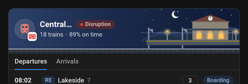 |
|  | 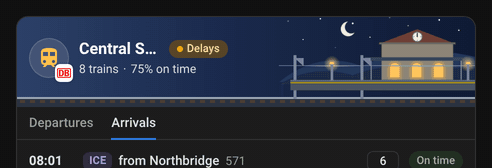 |

Forced night (`illustration_theme: night`):


### Departures and arrivals

| Light | Dark |
|---|---|
|  | 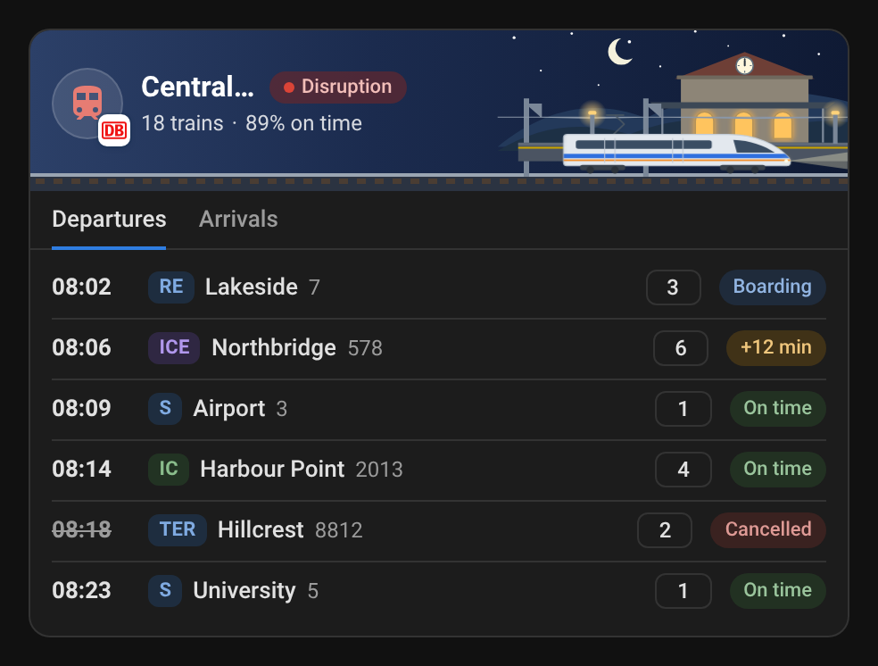 |
|  | 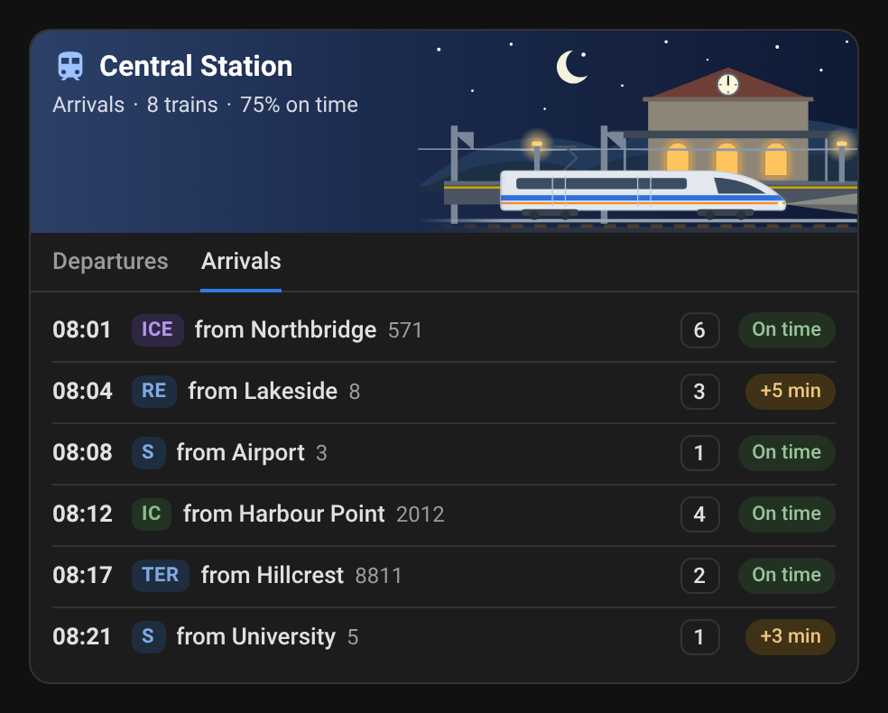 |

### Train details

| Light | Dark |
|---|---|
| 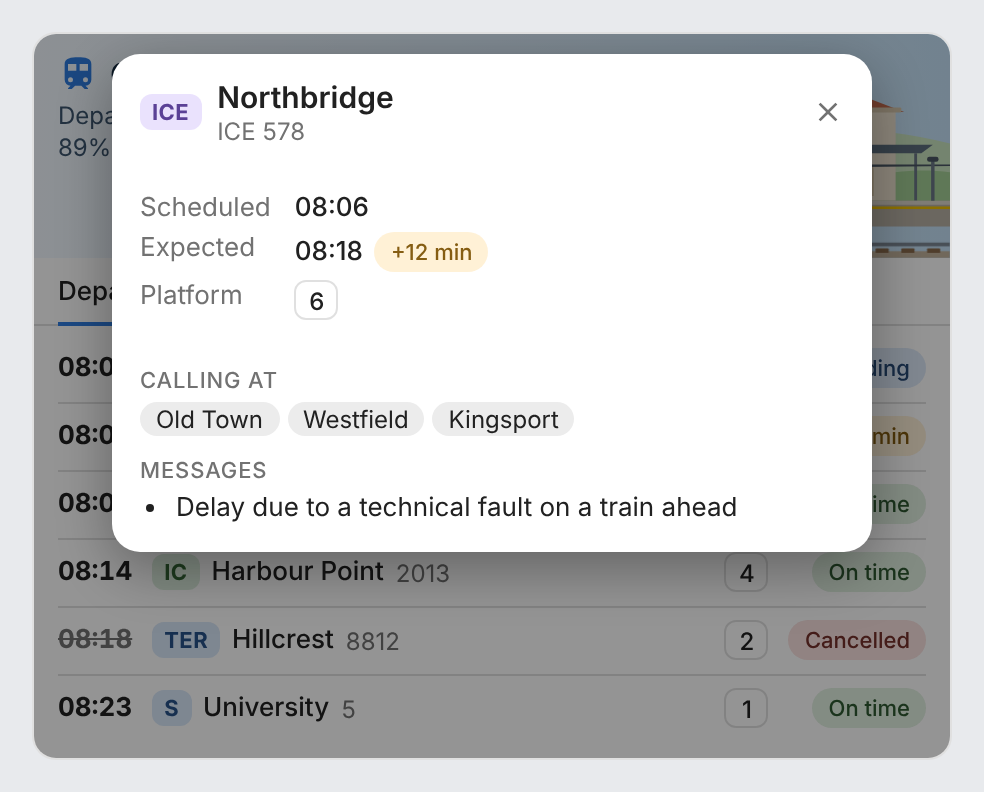 | 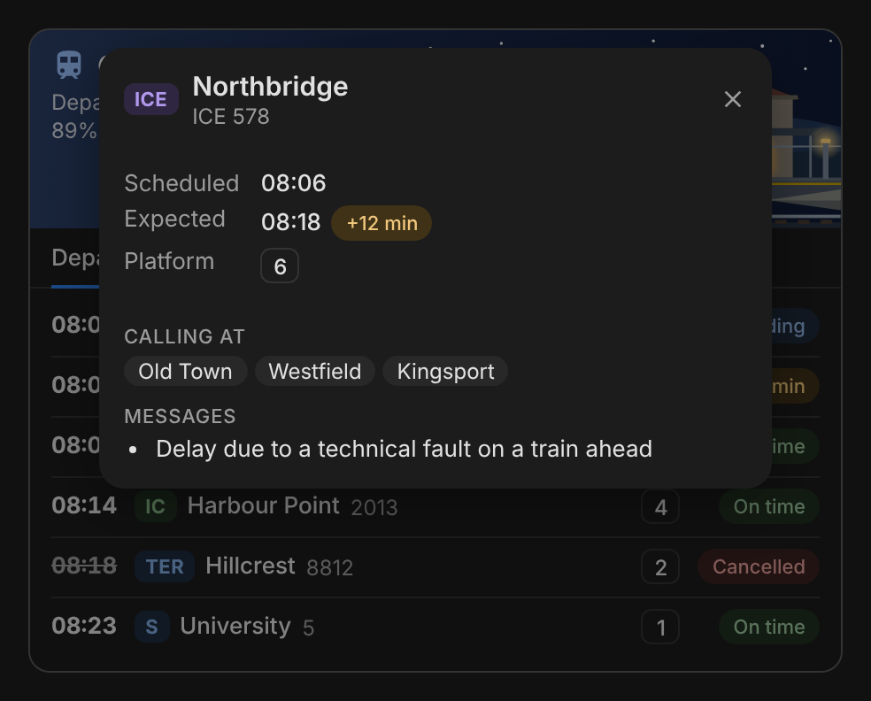 |

### Mini card

| Light | Dark |
|---|---|
|  | 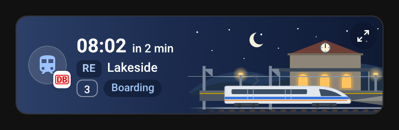 |
| 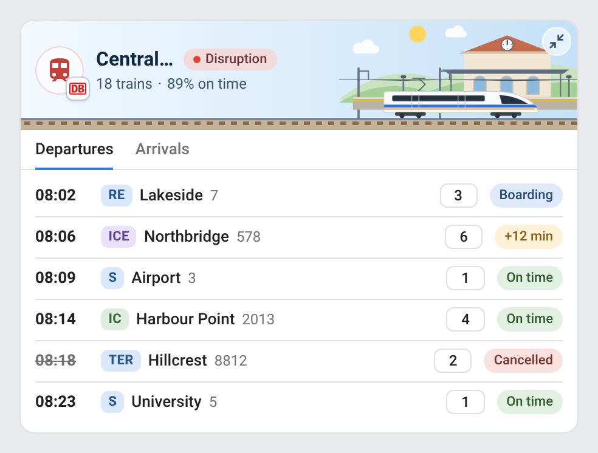 | 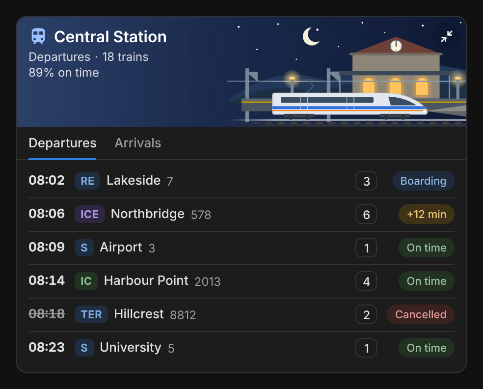 |
| 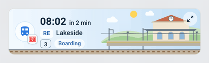 | 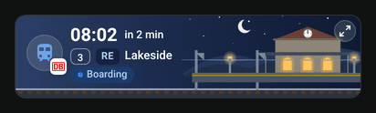 |

### Classic header and an integration without train types

| `illustration: false` | National Rail UK |
|---|---|
| <picture><source media="(prefers-color-scheme: dark)" srcset="https://raw.githubusercontent.com/juju35/ha-train-board-card/main/screenshots/card-classic-dark.png">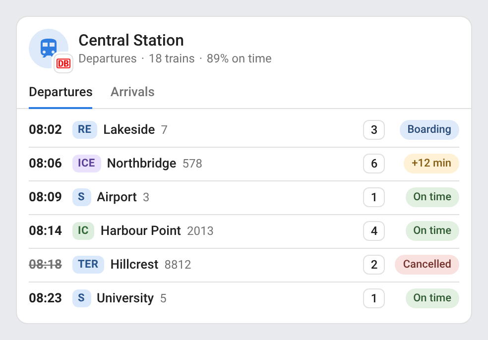</picture> | <picture><source media="(prefers-color-scheme: dark)" srcset="https://raw.githubusercontent.com/juju35/ha-train-board-card/main/screenshots/card-uk-dark.png">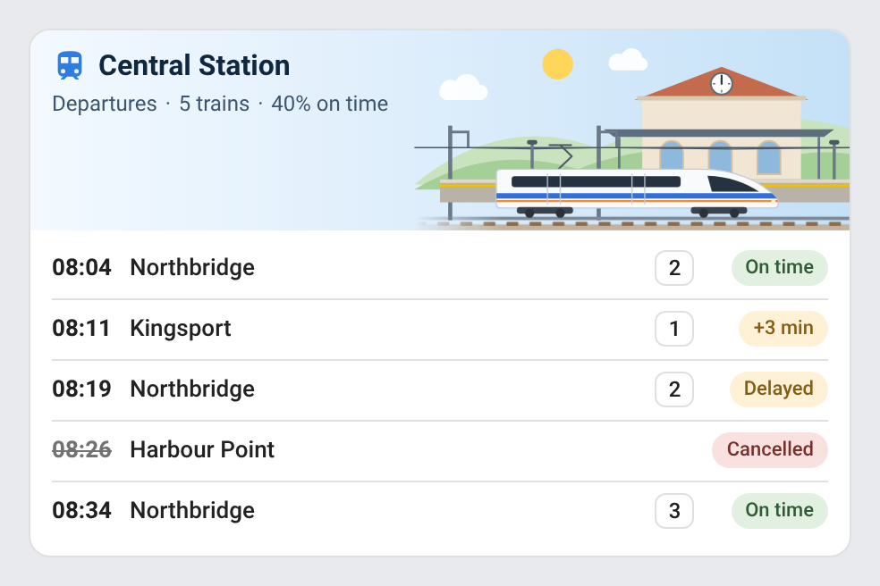</picture> |

## How it works

### Statuses

| Status | When |
|---|---|
| **On time** (green) | Real-time data without delay |
| **+N min** (orange) | N minutes behind the timetable |
| **Delayed** (orange) | Delayed without an expected time (National Rail « Delayed ») |
| **Boarding** (blue) | A departure two minutes away or less |
| **Arrived** (blue) | An arrival whose time has passed |
| **Cancelled** (red) | Cancelled; the time is struck through |

A train known from the timetable only (the « next » trains of Nederlandse Spoorwegen and Trafikverket, the later connections of Swiss public transport, a Public Transport departure without real time) has no status pill. A departure leaves the board a minute after its time, an arrival five minutes after. The share of trains on time counts the trains with real-time data; cancelled and delayed ones are not on time.

### Brand logos

The header icon carries the logo of the railway behind the detected integration, on a white tile readable in light and dark themes:

| Integration | Badge |
|---|---|
| DB Infoscreen | Deutsche Bahn |
| National Rail UK, National Rail Departure Times, UK Transport | National Rail |
| Nederlandse Spoorwegen | NS |
| Train Traveler | SNCF |
| GTFS2 | SNCF when the feed's agency is SNCF (TER, OUIGO, Intercités, TGV), else none |
| Swiss Transport, Swiss public transport | SBB CFF FFS |
| Trafikverket Train | Trafikverket (its emblem) |
| ViaggiaTreno | Trenitalia (its symbol) |
| NMBS / SNCB | SNCB / NMBS |
| Public Transport | The integration's own icon |

The logos are embedded in the card (no network). For the small badge, the wide logotypes of Trafikverket and Trenitalia are cut down to their emblem (`images/<brand>-mark.svg`); the README shows them whole, on a white tile. The Deutsche Bahn, National Rail, NS, SNCF and ÖBB logos come from [Simple Icons](https://simpleicons.org) (CC0), in each brand's colour.

### Train type colours

The pill of a train type is coloured by family: high speed (TGV, ICE, Frecciarossa, AVE, Railjet…) in violet, intercity (IC, EC, IR, Intercités, night trains…) in green, regional and suburban (TER, RE, RB, R, S, RER…) in blue, buses and others in grey. A Public Transport line keeps its own colour. `train_type_colors` (YAML only) sets your own, by category first, then by family:

```yaml
train_type_colors:
  TGV: "#7b1fa2"
  ICE: "#d81b60"
  high_speed: "#5e35b1"
  intercity: "#2e7d32"
  regional: "#00897b"
  suburban: "#1e88e5"
  bus: "#757575"
```

Colours are hexadecimal values, `rgb()` / `hsl()` values, colour names or `var(--a-theme-variable)`.

### Times

Integrations that give a local time (« 08:12 », « 2026-11-14 08:12 ») give it in Home Assistant's time zone: the card reads it there, not in the browser's time zone, and shows times in your profile's 12 / 24 hour and time zone settings. The relative time of the mini card (« in 8 min », « now ») and the statuses follow the clock.

### Narrow cards

The full card fits down to 6 columns of a sections view. The banner's text stops where the station starts; below about 300 px wide there is no room for both, and the banner keeps its sky alone. On a narrow card the train numbers give way first. In a container sized by its content, the cards take a width of 400 px instead of collapsing.

## Development

```bash
npm install
npm run build        # bundles src/ into dist/train-board-card.js (and its translation files)
npm run check        # builds and checks the card (run in CI)
npm test             # unit tests, and the browser layout tests when Chromium is installed
npm run screenshots  # renders the cards with mock data into screenshots/ (and the GIFs, needs ffmpeg)
```

The sources are `src/i18n.js` (translations), `src/adapters.js` (one adapter per integration, reading its entity into the card's train model), `src/scene.js` (the illustration) and `src/cards.js` (the cards and their editors). `dist/` is not committed: CI builds it on every push, and the release workflow attaches the built files to the release, which is where the Marketplace installs them from. On a pull request, the **Screenshots** workflow renders the screenshots and commits them to the pull request's branch.

### Releasing

1. Bump `version` in `package.json` and `package-lock.json`
2. Add a `## <version>` section at the top of [CHANGELOG.md](https://github.com/juju35/ha-train-board-card/blob/main/CHANGELOG.md)
3. Merge to `main`: the **Release** workflow builds the card, creates the tag and the GitHub release with the changelog section as notes, and attaches `train-board-card.js` and its translation files

## Translations

The cards auto-detect the language from your Home Assistant settings. Currently supported:

| Language | Code |
|---|---|
| English | `en` |
| Français | `fr` |
| Deutsch | `de` |
| Español | `es` |
| Српски (Serbian, Cyrillic) | `sr` |
| Srpski (Serbian, Latin) | `sr-Latn` |
| Italiano | `it` |
| Nederlands | `nl` |
| Português (Portugal) | `pt` |
| Polski | `pl` |
| Română | `ro` |
| Dansk | `da` |
| Svenska | `sv` |
| Български | `bg` |
| Русский | `ru` |
| Українська | `uk` |
| Magyar | `hu` |
| Slovenčina | `sk` |
| Čeština | `cs` |
| Slovenščina | `sl` |
| Latviešu | `lv` |
| Ελληνικά | `el` |

Contributions for additional languages are welcome!

## Contributing

Issues and pull requests are welcome. Another integration of train departures? Open an issue with a copy of its sensor's attributes (**Developer tools → States**), and it can get its own adapter in `src/adapters.js`, with a test fixture in `test/fixtures.mjs`. Before a pull request, run `npm test` and `npm run check`; the Lint workflow runs pre-commit, Biome and jscpd.

## Credits

The illustration is an original drawing: the train is generic and carries no operator livery or logo. Several brand logos of the badges come from [Simple Icons](https://simpleicons.org) (CC0); Deutsche Bahn, National Rail, NS, SNCF, ÖBB, SBB, Trafikverket, Trenitalia and SNCB / NMBS and their logos are trademarks of their owners. Integration names belong to their authors and to the railway operators whose data they read; this project is not affiliated with any of them.

## License

[MIT](https://github.com/juju35/ha-train-board-card/blob/main/LICENSE)

## Support

If you find this project useful, you can support its development:

<a href="https://buymeacoffee.com/julienstep9"></a>
